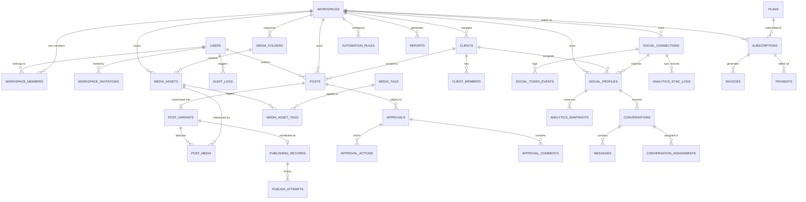

# SOCIALPILOTX — DATABASE SCHEMA & ERD SPECIFICATION
**Document ID:** `SPX-DOC-002`  
**Phase:** `Phase 0 — Database Architecture & Data Modeling`  
**Engine:** MySQL 8.0+ (InnoDB, UTF8MB4 Unicode, Strict Mode)

---

## 1. Visual Entity Relationship Diagram (ERD)

---

## 2. Strict Multi-Tenant Isolation Strategy

1. **Shared Database, Shared Schema with Logical Workspace Isolation**: Every business entity (posts, media, connections, profiles, clients, approvals, automations) **MUST** carry an indexed `workspace_id` column.
2. **Eloquent Global Scope (`TenantScope`)**: Automatically appends `WHERE workspace_id = ?` to all SELECT, UPDATE, and DELETE operations.
3. **Database Constraints & Composite Unique Keys**: Unique constraints on identifiers (e.g. `client_code`, `slug`, `external_id`) are always compound with `workspace_id` to prevent cross-tenant collision while allowing duplicate naming across different workspaces.
4. **Foreign Key Enforcement**: `ON DELETE RESTRICT` is strictly applied on core business records (clients, connections with active scheduled posts) to prevent accidental data loss. Cascades are used only for dependent relational items (e.g. `post_variants` cascade on post delete).

---

## 3. Detailed Table Specifications (All 38 Tables)

### Table 1: `users`
- **Purpose**: System credentials, identity, and profile for every human operator (agency staff, freelancer, client reviewer, admin).
- **Columns**:
  - `id`: BIGINT UNSIGNED AUTO_INCREMENT PRIMARY KEY
  - `name`: VARCHAR(255) NOT NULL
  - `email`: VARCHAR(255) NOT NULL UNIQUE
  - `password`: VARCHAR(255) NOT NULL
  - `avatar_url`: VARCHAR(1024) NULLABLE
  - `phone`: VARCHAR(50) NULLABLE
  - `timezone`: VARCHAR(64) NOT NULL DEFAULT 'UTC' (IANA timezone name)
  - `email_verified_at`: TIMESTAMP NULLABLE
  - `is_super_admin`: BOOLEAN NOT NULL DEFAULT FALSE
  - `remember_token`: VARCHAR(100) NULLABLE
  - `created_at`, `updated_at`: TIMESTAMP NULLABLE
  - `deleted_at`: TIMESTAMP NULLABLE (Soft Deletes)
- **Indexes**: `INDEX idx_users_email (email)`, `INDEX idx_users_super_admin (is_super_admin)`

---

### Table 2: `workspaces`
- **Purpose**: Top-level tenant container representing an agency, company, or freelancer account. Holds subscription and ownership.
- **Columns**:
  - `id`: BIGINT UNSIGNED AUTO_INCREMENT PRIMARY KEY
  - `uuid`: CHAR(36) NOT NULL UNIQUE (Public tenant reference)
  - `name`: VARCHAR(255) NOT NULL
  - `slug`: VARCHAR(255) NOT NULL UNIQUE
  - `owner_id`: BIGINT UNSIGNED NOT NULL (Foreign key -> `users.id`)
  - `logo_url`: VARCHAR(1024) NULLABLE
  - `timezone`: VARCHAR(64) NOT NULL DEFAULT 'UTC'
  - `currency`: CHAR(3) NOT NULL DEFAULT 'INR' (INR, USD, EUR)
  - `settings`: JSON NULLABLE (Default posting delays, watermark settings, notification prefs)
  - `is_active`: BOOLEAN NOT NULL DEFAULT TRUE
  - `created_at`, `updated_at`: TIMESTAMP NULLABLE
  - `deleted_at`: TIMESTAMP NULLABLE
- **Foreign Keys**: `owner_id` REFERENCES `users(id)` ON DELETE RESTRICT
- **Indexes**: `INDEX idx_workspaces_slug (slug)`, `INDEX idx_workspaces_owner (owner_id)`

---

### Table 3: `workspace_members`
- **Purpose**: Association table between users and workspaces defining workspace-specific roles and permissions.
- **Columns**:
  - `id`: BIGINT UNSIGNED AUTO_INCREMENT PRIMARY KEY
  - `workspace_id`: BIGINT UNSIGNED NOT NULL
  - `user_id`: BIGINT UNSIGNED NOT NULL
  - `role`: ENUM('owner', 'admin', 'manager', 'editor', 'client_viewer') NOT NULL DEFAULT 'editor'
  - `permissions`: JSON NULLABLE (Granular overrides: can_publish, can_approve, can_manage_billing)
  - `is_active`: BOOLEAN NOT NULL DEFAULT TRUE
  - `joined_at`: TIMESTAMP NOT NULL DEFAULT CURRENT_TIMESTAMP
  - `created_at`, `updated_at`: TIMESTAMP NULLABLE
- **Foreign Keys**: `workspace_id` REFERENCES `workspaces(id)` ON DELETE CASCADE, `user_id` REFERENCES `users(id)` ON DELETE CASCADE
- **Unique Constraints**: `UNIQUE uq_workspace_user (workspace_id, user_id)`

---

### Table 4: `workspace_invitations`
- **Purpose**: Pending invitations sent to email addresses to join a workspace.
- **Columns**:
  - `id`: BIGINT UNSIGNED AUTO_INCREMENT PRIMARY KEY
  - `workspace_id`: BIGINT UNSIGNED NOT NULL
  - `inviter_id`: BIGINT UNSIGNED NOT NULL (Foreign key -> `users.id`)
  - `email`: VARCHAR(255) NOT NULL
  - `role`: ENUM('admin', 'manager', 'editor', 'client_viewer') NOT NULL DEFAULT 'editor'
  - `token`: VARCHAR(64) NOT NULL UNIQUE
  - `expires_at`: TIMESTAMP NOT NULL
  - `accepted_at`: TIMESTAMP NULLABLE
  - `created_at`, `updated_at`: TIMESTAMP NULLABLE
- **Foreign Keys**: `workspace_id` REFERENCES `workspaces(id)` ON DELETE CASCADE, `inviter_id` REFERENCES `users(id)` ON DELETE CASCADE
- **Indexes**: `INDEX idx_invitation_email (email)`, `INDEX idx_invitation_token (token)`

---

### Table 5: `clients`
- **Purpose**: External clients managed by an agency workspace (e.g. "Sharma Restaurant", "Fashion Store").
- **Columns**:
  - `id`: BIGINT UNSIGNED AUTO_INCREMENT PRIMARY KEY
  - `workspace_id`: BIGINT UNSIGNED NOT NULL
  - `name`: VARCHAR(255) NOT NULL
  - `client_code`: VARCHAR(50) NOT NULL (Short identifier, e.g. "SHR-01")
  - `contact_person`: VARCHAR(255) NULLABLE
  - `contact_email`: VARCHAR(255) NULLABLE
  - `contact_phone`: VARCHAR(50) NULLABLE
  - `logo_url`: VARCHAR(1024) NULLABLE
  - `timezone`: VARCHAR(64) NOT NULL DEFAULT 'UTC'
  - `status`: ENUM('active', 'paused', 'archived') NOT NULL DEFAULT 'active'
  - `notes`: TEXT NULLABLE
  - `created_at`, `updated_at`: TIMESTAMP NULLABLE
  - `deleted_at`: TIMESTAMP NULLABLE
- **Foreign Keys**: `workspace_id` REFERENCES `workspaces(id)` ON DELETE CASCADE
- **Unique Constraints**: `UNIQUE uq_client_code (workspace_id, client_code)`

---

### Table 6: `client_members`
- **Purpose**: Associates workspace members (or client viewers) to specific clients, restricting client users from seeing other agency clients.
- **Columns**:
  - `id`: BIGINT UNSIGNED AUTO_INCREMENT PRIMARY KEY
  - `client_id`: BIGINT UNSIGNED NOT NULL
  - `user_id`: BIGINT UNSIGNED NOT NULL
  - `can_approve`: BOOLEAN NOT NULL DEFAULT FALSE
  - `created_at`, `updated_at`: TIMESTAMP NULLABLE
- **Foreign Keys**: `client_id` REFERENCES `clients(id)` ON DELETE CASCADE, `user_id` REFERENCES `users(id)` ON DELETE CASCADE
- **Unique Constraints**: `UNIQUE uq_client_user (client_id, user_id)`

---

### Table 7: `social_connections`
- **Purpose**: Authorized OAuth connection with an external platform entity (e.g., a Facebook user login or Google OAuth grant).
- **Columns**:
  - `id`: BIGINT UNSIGNED AUTO_INCREMENT PRIMARY KEY
  - `workspace_id`: BIGINT UNSIGNED NOT NULL
  - `platform`: ENUM('facebook', 'instagram', 'linkedin', 'youtube', 'tiktok', 'pinterest', 'x', 'threads', 'google_business', 'bluesky') NOT NULL
  - `account_id`: VARCHAR(255) NOT NULL (Provider's native user/account ID)
  - `account_name`: VARCHAR(255) NOT NULL (Display name on provider)
  - `account_email`: VARCHAR(255) NULLABLE
  - `avatar_url`: VARCHAR(1024) NULLABLE
  - `access_token`: TEXT NOT NULL (Encrypted with AES-256-GCM via `Illuminate\Support\Facades\Crypt`)
  - `refresh_token`: TEXT NULLABLE (Encrypted with AES-256-GCM)
  - `token_expires_at`: TIMESTAMP NULLABLE
  - `refresh_token_expires_at`: TIMESTAMP NULLABLE
  - `scopes`: JSON NOT NULL (Array of granted permissions)
  - `status`: ENUM('connected', 'expired', 'reauthorization_required', 'permission_missing', 'disconnected', 'error') NOT NULL DEFAULT 'connected'
  - `last_error_message`: TEXT NULLABLE
  - `last_sync_at`: TIMESTAMP NULLABLE
  - `created_at`, `updated_at`: TIMESTAMP NULLABLE
  - `deleted_at`: TIMESTAMP NULLABLE
- **Foreign Keys**: `workspace_id` REFERENCES `workspaces(id)` ON DELETE CASCADE
- **Unique Constraints**: `UNIQUE uq_workspace_platform_account (workspace_id, platform, account_id)`
- **Indexes**: `INDEX idx_connection_status (status)`, `INDEX idx_token_expiry (token_expires_at)`

---

### Table 8: `social_profiles`
- **Purpose**: Individual pages, channels, business accounts, or locations derived from a connection (e.g., specific Facebook Page, Instagram Business Account, YouTube Channel, LinkedIn Company Page).
- **Columns**:
  - `id`: BIGINT UNSIGNED AUTO_INCREMENT PRIMARY KEY
  - `workspace_id`: BIGINT UNSIGNED NOT NULL
  - `client_id`: BIGINT UNSIGNED NULLABLE (Associated client)
  - `connection_id`: BIGINT UNSIGNED NOT NULL (Parent connection)
  - `platform`: VARCHAR(50) NOT NULL
  - `profile_id`: VARCHAR(255) NOT NULL (Native ID: Page ID, IG ID, Channel ID)
  - `name`: VARCHAR(255) NOT NULL
  - `username`: VARCHAR(255) NULLABLE
  - `avatar_url`: VARCHAR(1024) NULLABLE
  - `profile_url`: VARCHAR(1024) NULLABLE
  - `access_token`: TEXT NULLABLE (Encrypted page-specific token if distinct from user token)
  - `capabilities`: JSON NOT NULL (Derived capability flags, e.g. text, images, video, reels, carousel)
  - `metadata`: JSON NULLABLE (Category, follower counts, verified badges, location address)
  - `is_active`: BOOLEAN NOT NULL DEFAULT TRUE
  - `publishing_enabled`: BOOLEAN NOT NULL DEFAULT TRUE
  - `last_health_check_at`: TIMESTAMP NULLABLE
  - `created_at`, `updated_at`: TIMESTAMP NULLABLE
  - `deleted_at`: TIMESTAMP NULLABLE
- **Foreign Keys**: `workspace_id` REFERENCES `workspaces(id)` ON DELETE CASCADE, `client_id` REFERENCES `clients(id)` ON DELETE SET NULL, `connection_id` REFERENCES `social_connections(id)` ON DELETE CASCADE
- **Unique Constraints**: `UNIQUE uq_workspace_platform_profile (workspace_id, platform, profile_id)`
- **Indexes**: `INDEX idx_profiles_client (client_id)`, `INDEX idx_profiles_active (is_active, publishing_enabled)`

---

### Table 9: `oauth_transactions`
- **Purpose**: Ephemeral, high-security state tracker for in-flight OAuth authorizations to prevent CSRF, workspace injection, and replay attacks.
- **Columns**:
  - `id`: BIGINT UNSIGNED AUTO_INCREMENT PRIMARY KEY
  - `state_token`: VARCHAR(128) NOT NULL UNIQUE
  - `workspace_id`: BIGINT UNSIGNED NOT NULL
  - `user_id`: BIGINT UNSIGNED NOT NULL
  - `platform`: VARCHAR(50) NOT NULL
  - `code_verifier`: VARCHAR(255) NULLABLE (For PKCE flow: X, Pinterest, TikTok)
  - `redirect_url`: VARCHAR(1024) NOT NULL
  - `metadata`: JSON NULLABLE (Client binding, intent)
  - `is_consumed`: BOOLEAN NOT NULL DEFAULT FALSE
  - `expires_at`: TIMESTAMP NOT NULL
  - `created_at`, `updated_at`: TIMESTAMP NULLABLE
- **Foreign Keys**: `workspace_id` REFERENCES `workspaces(id)` ON DELETE CASCADE, `user_id` REFERENCES `users(id)` ON DELETE CASCADE
- **Indexes**: `INDEX idx_oauth_state (state_token, is_consumed, expires_at)`

---

### Table 10: `social_token_events`
- **Purpose**: Immutable audit log of token lifecycle events (creation, refresh, expiration, failure, manual reauthorization).
- **Columns**:
  - `id`: BIGINT UNSIGNED AUTO_INCREMENT PRIMARY KEY
  - `connection_id`: BIGINT UNSIGNED NOT NULL
  - `event_type`: ENUM('created', 'refreshed', 'refresh_failed', 'expired', 'revoked', 'permission_lost') NOT NULL
  - `details`: JSON NULLABLE (Response status code, error message, remaining validity in seconds)
  - `occurred_at`: TIMESTAMP NOT NULL DEFAULT CURRENT_TIMESTAMP
- **Foreign Keys**: `connection_id` REFERENCES `social_connections(id)` ON DELETE CASCADE
- **Indexes**: `INDEX idx_token_events (connection_id, event_type, occurred_at)`

---

### Table 11: `posts`
- **Purpose**: Root parent content container created by a user, containing core caption and metadata before variant customization.
- **Columns**:
  - `id`: BIGINT UNSIGNED AUTO_INCREMENT PRIMARY KEY
  - `uuid`: CHAR(36) NOT NULL UNIQUE
  - `workspace_id`: BIGINT UNSIGNED NOT NULL
  - `client_id`: BIGINT UNSIGNED NULLABLE
  - `author_id`: BIGINT UNSIGNED NOT NULL (Foreign key -> `users.id`)
  - `title`: VARCHAR(255) NULLABLE (Internal reference title)
  - `base_caption`: TEXT NULLABLE (Master caption copied into variants)
  - `destination_link`: VARCHAR(2048) NULLABLE
  - `status`: ENUM('draft', 'pending_approval', 'approved', 'scheduled', 'queued', 'publishing', 'published', 'partially_published', 'failed', 'cancelled') NOT NULL DEFAULT 'draft'
  - `scheduled_at`: TIMESTAMP NULLABLE (Master scheduled time in UTC)
  - `timezone`: VARCHAR(64) NOT NULL DEFAULT 'UTC' (Original creator timezone)
  - `requires_approval`: BOOLEAN NOT NULL DEFAULT FALSE
  - `revision`: INT UNSIGNED NOT NULL DEFAULT 1 (Incremented on edit after approval)
  - `created_at`, `updated_at`: TIMESTAMP NULLABLE
  - `deleted_at`: TIMESTAMP NULLABLE
- **Foreign Keys**: `workspace_id` REFERENCES `workspaces(id)` ON DELETE CASCADE, `client_id` REFERENCES `clients(id)` ON DELETE SET NULL, `author_id` REFERENCES `users(id)` ON DELETE RESTRICT
- **Indexes**: `INDEX idx_posts_workspace_status (workspace_id, status)`, `INDEX idx_posts_schedule (scheduled_at, status)`

---

### Table 12: `post_variants`
- **Purpose**: Customized version of the post for a particular social profile (allows tailored captions, hashtags, platform-specific settings, and media ordering).
- **Columns**:
  - `id`: BIGINT UNSIGNED AUTO_INCREMENT PRIMARY KEY
  - `post_id`: BIGINT UNSIGNED NOT NULL
  - `social_profile_id`: BIGINT UNSIGNED NOT NULL
  - `custom_caption`: TEXT NULLABLE (Overrides or adapts `base_caption`)
  - `platform_settings`: JSON NULLABLE (e.g., Pinterest Board ID, YouTube Category & Privacy, TikTok privacy settings, Instagram first comment)
  - `status`: ENUM('draft', 'pending_approval', 'approved', 'scheduled', 'queued', 'publishing', 'published', 'failed', 'cancelled') NOT NULL DEFAULT 'draft'
  - `scheduled_at`: TIMESTAMP NULLABLE (UTC)
  - `published_at`: TIMESTAMP NULLABLE (UTC)
  - `external_post_id`: VARCHAR(255) NULLABLE (Returned post ID from provider)
  - `external_post_url`: VARCHAR(1024) NULLABLE (Public URL to published post)
  - `error_message`: TEXT NULLABLE
  - `retry_count`: TINYINT UNSIGNED NOT NULL DEFAULT 0
  - `created_at`, `updated_at`: TIMESTAMP NULLABLE
- **Foreign Keys**: `post_id` REFERENCES `posts(id)` ON DELETE CASCADE, `social_profile_id` REFERENCES `social_profiles(id)` ON DELETE CASCADE
- **Unique Constraints**: `UNIQUE uq_post_variant_profile (post_id, social_profile_id)`
- **Indexes**: `INDEX idx_variant_schedule_status (scheduled_at, status)`

---

### Table 13: `post_media`
- **Purpose**: Association of media assets to post variants with explicit display order.
- **Columns**:
  - `id`: BIGINT UNSIGNED AUTO_INCREMENT PRIMARY KEY
  - `post_variant_id`: BIGINT UNSIGNED NOT NULL
  - `media_asset_id`: BIGINT UNSIGNED NOT NULL
  - `sort_order`: TINYINT UNSIGNED NOT NULL DEFAULT 0
  - `custom_alt_text`: VARCHAR(500) NULLABLE
  - `created_at`: TIMESTAMP NOT NULL DEFAULT CURRENT_TIMESTAMP
- **Foreign Keys**: `post_variant_id` REFERENCES `post_variants(id)` ON DELETE CASCADE, `media_asset_id` REFERENCES `media_assets(id)` ON DELETE RESTRICT
- **Indexes**: `INDEX idx_post_media_order (post_variant_id, sort_order)`

---

### Table 14: `publishing_records`
- **Purpose**: Engine-level tracking and locking record for publishing execution.
- **Columns**:
  - `id`: BIGINT UNSIGNED AUTO_INCREMENT PRIMARY KEY
  - `post_variant_id`: BIGINT UNSIGNED NOT NULL UNIQUE
  - `idempotency_key`: VARCHAR(128) NOT NULL UNIQUE (UUID generated per scheduled run)
  - `status`: ENUM('pending', 'queued', 'processing', 'completed', 'failed', 'cancelled') NOT NULL DEFAULT 'pending'
  - `locked_at`: TIMESTAMP NULLABLE
  - `locked_by`: VARCHAR(255) NULLABLE (Worker hostname/PID)
  - `started_at`: TIMESTAMP NULLABLE
  - `completed_at`: TIMESTAMP NULLABLE
  - `created_at`, `updated_at`: TIMESTAMP NULLABLE
- **Foreign Keys**: `post_variant_id` REFERENCES `post_variants(id)` ON DELETE CASCADE
- **Indexes**: `INDEX idx_publishing_status (status, locked_at)`

---

### Table 15: `publish_attempts`
- **Purpose**: Complete audit history of every HTTP call / attempt made to social providers.
- **Columns**:
  - `id`: BIGINT UNSIGNED AUTO_INCREMENT PRIMARY KEY
  - `publishing_record_id`: BIGINT UNSIGNED NOT NULL
  - `attempt_number`: TINYINT UNSIGNED NOT NULL DEFAULT 1
  - `request_payload`: JSON NULLABLE (Sanitized - NO secrets)
  - `response_status_code`: INT NULLABLE
  - `response_body`: JSON NULLABLE
  - `provider_error_code`: VARCHAR(100) NULLABLE
  - `provider_error_message`: TEXT NULLABLE
  - `duration_ms`: INT UNSIGNED NULLABLE
  - `created_at`: TIMESTAMP NOT NULL DEFAULT CURRENT_TIMESTAMP
- **Foreign Keys**: `publishing_record_id` REFERENCES `publishing_records(id)` ON DELETE CASCADE
- **Indexes**: `INDEX idx_attempts_record (publishing_record_id, attempt_number)`

---

### Table 16: `media_assets`
- **Purpose**: Workspace media files stored on Cloudflare R2 / S3.
- **Columns**:
  - `id`: BIGINT UNSIGNED AUTO_INCREMENT PRIMARY KEY
  - `uuid`: CHAR(36) NOT NULL UNIQUE
  - `workspace_id`: BIGINT UNSIGNED NOT NULL
  - `uploader_id`: BIGINT UNSIGNED NOT NULL (Foreign key -> `users.id`)
  - `folder_id`: BIGINT UNSIGNED NULLABLE (Foreign key -> `media_folders.id`)
  - `file_name`: VARCHAR(255) NOT NULL
  - `storage_path`: VARCHAR(1024) NOT NULL (Key in R2/S3 bucket)
  - `disk`: VARCHAR(50) NOT NULL DEFAULT 'r2'
  - `mime_type`: VARCHAR(100) NOT NULL
  - `file_size`: BIGINT UNSIGNED NOT NULL (Bytes)
  - `media_type`: ENUM('image', 'video', 'gif', 'document') NOT NULL
  - `width`: INT UNSIGNED NULLABLE
  - `height`: INT UNSIGNED NULLABLE
  - `duration_seconds`: DECIMAL(8,2) NULLABLE (For videos)
  - `aspect_ratio`: VARCHAR(20) NULLABLE (e.g., '1:1', '16:9', '9:16')
  - `public_url`: VARCHAR(1024) NOT NULL (CDN URL)
  - `thumbnail_url`: VARCHAR(1024) NULLABLE
  - `metadata`: JSON NULLABLE
  - `created_at`, `updated_at`: TIMESTAMP NULLABLE
  - `deleted_at`: TIMESTAMP NULLABLE
- **Foreign Keys**: `workspace_id` REFERENCES `workspaces(id)` ON DELETE CASCADE, `uploader_id` REFERENCES `users(id)` ON DELETE RESTRICT, `folder_id` REFERENCES `media_folders(id)` ON DELETE SET NULL
- **Indexes**: `INDEX idx_media_workspace_folder (workspace_id, folder_id)`, `INDEX idx_media_type (media_type)`

---

### Table 17: `media_folders`
- **Purpose**: Directory structure in the media library.
- **Columns**:
  - `id`: BIGINT UNSIGNED AUTO_INCREMENT PRIMARY KEY
  - `workspace_id`: BIGINT UNSIGNED NOT NULL
  - `parent_id`: BIGINT UNSIGNED NULLABLE (Self-referencing for nested folders)
  - `name`: VARCHAR(255) NOT NULL
  - `created_at`, `updated_at`: TIMESTAMP NULLABLE
- **Foreign Keys**: `workspace_id` REFERENCES `workspaces(id)` ON DELETE CASCADE, `parent_id` REFERENCES `media_folders(id)` ON DELETE CASCADE
- **Unique Constraints**: `UNIQUE uq_folder_name_parent (workspace_id, parent_id, name)`

---

### Table 18: `media_tags`
- **Purpose**: Tagging taxonomy for media categorization.
- **Columns**:
  - `id`: BIGINT UNSIGNED AUTO_INCREMENT PRIMARY KEY
  - `workspace_id`: BIGINT UNSIGNED NOT NULL
  - `name`: VARCHAR(100) NOT NULL
  - `created_at`, `updated_at`: TIMESTAMP NULLABLE
- **Foreign Keys**: `workspace_id` REFERENCES `workspaces(id)` ON DELETE CASCADE
- **Unique Constraints**: `UNIQUE uq_tag_name (workspace_id, name)`

---

### Table 19: `media_asset_tags`
- **Purpose**: Pivot between `media_assets` and `media_tags`.
- **Columns**:
  - `media_asset_id`: BIGINT UNSIGNED NOT NULL
  - `media_tag_id`: BIGINT UNSIGNED NOT NULL
  - PRIMARY KEY (`media_asset_id`, `media_tag_id`)
- **Foreign Keys**: `media_asset_id` REFERENCES `media_assets(id)` ON DELETE CASCADE, `media_tag_id` REFERENCES `media_tags(id)` ON DELETE CASCADE

---

### Table 20: `approvals`
- **Purpose**: State machine record tracking post approval workflow.
- **Columns**:
  - `id`: BIGINT UNSIGNED AUTO_INCREMENT PRIMARY KEY
  - `post_id`: BIGINT UNSIGNED NOT NULL UNIQUE
  - `workspace_id`: BIGINT UNSIGNED NOT NULL
  - `status`: ENUM('pending', 'approved', 'rejected', 'changes_requested') NOT NULL DEFAULT 'pending'
  - `current_stage`: ENUM('manager_review', 'client_review') NOT NULL DEFAULT 'manager_review'
  - `requested_by`: BIGINT UNSIGNED NOT NULL (User)
  - `assigned_to`: BIGINT UNSIGNED NULLABLE (Designated reviewer)
  - `reviewed_by`: BIGINT UNSIGNED NULLABLE (Final decider)
  - `reviewed_at`: TIMESTAMP NULLABLE
  - `rejection_reason`: TEXT NULLABLE
  - `created_at`, `updated_at`: TIMESTAMP NULLABLE
- **Foreign Keys**: `post_id` REFERENCES `posts(id)` ON DELETE CASCADE, `workspace_id` REFERENCES `workspaces(id)` ON DELETE CASCADE, `requested_by` REFERENCES `users(id)` ON DELETE RESTRICT, `assigned_to` REFERENCES `users(id)` ON DELETE SET NULL, `reviewed_by` REFERENCES `users(id)` ON DELETE SET NULL
- **Indexes**: `INDEX idx_approval_status (workspace_id, status, current_stage)`

---

### Table 21: `approval_actions`
- **Purpose**: Audit log of transitions in an approval flow (submitted, changes requested, approved, re-submitted).
- **Columns**:
  - `id`: BIGINT UNSIGNED AUTO_INCREMENT PRIMARY KEY
  - `approval_id`: BIGINT UNSIGNED NOT NULL
  - `user_id`: BIGINT UNSIGNED NOT NULL
  - `action`: ENUM('submitted', 'approved', 'rejected', 'requested_changes') NOT NULL
  - `note`: TEXT NULLABLE
  - `created_at`: TIMESTAMP NOT NULL DEFAULT CURRENT_TIMESTAMP
- **Foreign Keys**: `approval_id` REFERENCES `approvals(id)` ON DELETE CASCADE, `user_id` REFERENCES `users(id)` ON DELETE RESTRICT
- **Indexes**: `INDEX idx_approval_actions (approval_id, created_at)`

---

### Table 22: `approval_comments`
- **Purpose**: Discussion thread between agency team members and clients on a post awaiting approval.
- **Columns**:
  - `id`: BIGINT UNSIGNED AUTO_INCREMENT PRIMARY KEY
  - `approval_id`: BIGINT UNSIGNED NOT NULL
  - `user_id`: BIGINT UNSIGNED NOT NULL
  - `is_internal`: BOOLEAN NOT NULL DEFAULT FALSE (Agency-only comments hidden from clients)
  - `message`: TEXT NOT NULL
  - `created_at`, `updated_at`: TIMESTAMP NULLABLE
- **Foreign Keys**: `approval_id` REFERENCES `approvals(id)` ON DELETE CASCADE, `user_id` REFERENCES `users(id)` ON DELETE RESTRICT
- **Indexes**: `INDEX idx_approval_comments (approval_id, is_internal)`

---

### Table 23: `conversations`
- **Purpose**: Social inbox conversation thread (post comments thread, direct message thread where supported).
- **Columns**:
  - `id`: BIGINT UNSIGNED AUTO_INCREMENT PRIMARY KEY
  - `workspace_id`: BIGINT UNSIGNED NOT NULL
  - `social_profile_id`: BIGINT UNSIGNED NOT NULL
  - `external_conversation_id`: VARCHAR(255) NOT NULL
  - `type`: ENUM('comment_thread', 'direct_message', 'mention') NOT NULL
  - `sender_name`: VARCHAR(255) NOT NULL
  - `sender_avatar`: VARCHAR(1024) NULLABLE
  - `sender_profile_id`: VARCHAR(255) NOT NULL
  - `snippet`: TEXT NULLABLE (Last message preview)
  - `status`: ENUM('open', 'resolved', 'spam', 'archived') NOT NULL DEFAULT 'open'
  - `is_unread`: BOOLEAN NOT NULL DEFAULT TRUE
  - `last_activity_at`: TIMESTAMP NOT NULL
  - `created_at`, `updated_at`: TIMESTAMP NULLABLE
- **Foreign Keys**: `workspace_id` REFERENCES `workspaces(id)` ON DELETE CASCADE, `social_profile_id` REFERENCES `social_profiles(id)` ON DELETE CASCADE
- **Unique Constraints**: `UNIQUE uq_profile_conversation (social_profile_id, external_conversation_id)`
- **Indexes**: `INDEX idx_conversation_status (workspace_id, status, is_unread)`

---

### Table 24: `messages`
- **Purpose**: Individual messages or comments within a conversation.
- **Columns**:
  - `id`: BIGINT UNSIGNED AUTO_INCREMENT PRIMARY KEY
  - `conversation_id`: BIGINT UNSIGNED NOT NULL
  - `external_message_id`: VARCHAR(255) NOT NULL
  - `direction`: ENUM('inbound', 'outbound') NOT NULL
  - `sender_name`: VARCHAR(255) NOT NULL
  - `sender_id`: VARCHAR(255) NOT NULL
  - `body`: TEXT NOT NULL
  - `attachments`: JSON NULLABLE (Media URLs)
  - `is_hidden`: BOOLEAN NOT NULL DEFAULT FALSE
  - `sent_by_user_id`: BIGINT UNSIGNED NULLABLE (For outbound replies made by team member)
  - `sent_at`: TIMESTAMP NOT NULL
  - `created_at`, `updated_at`: TIMESTAMP NULLABLE
- **Foreign Keys**: `conversation_id` REFERENCES `conversations(id)` ON DELETE CASCADE, `sent_by_user_id` REFERENCES `users(id)` ON DELETE SET NULL
- **Unique Constraints**: `UNIQUE uq_conv_ext_msg (conversation_id, external_message_id)`
- **Indexes**: `INDEX idx_messages_sent_at (conversation_id, sent_at)`

---

### Table 25: `conversation_assignments`
- **Purpose**: Tracks assignment of an inbox thread to a team member.
- **Columns**:
  - `id`: BIGINT UNSIGNED AUTO_INCREMENT PRIMARY KEY
  - `conversation_id`: BIGINT UNSIGNED NOT NULL
  - `assigned_to_user_id`: BIGINT UNSIGNED NOT NULL
  - `assigned_by_user_id`: BIGINT UNSIGNED NOT NULL
  - `created_at`: TIMESTAMP NOT NULL DEFAULT CURRENT_TIMESTAMP
- **Foreign Keys**: `conversation_id` REFERENCES `conversations(id)` ON DELETE CASCADE, `assigned_to_user_id` REFERENCES `users(id)` ON DELETE CASCADE, `assigned_by_user_id` REFERENCES `users(id)` ON DELETE CASCADE

---

### Table 26: `analytics_snapshots`
- **Purpose**: Time-series metric snapshots harvested from social providers.
- **Columns**:
  - `id`: BIGINT UNSIGNED AUTO_INCREMENT PRIMARY KEY
  - `workspace_id`: BIGINT UNSIGNED NOT NULL
  - `social_profile_id`: BIGINT UNSIGNED NOT NULL
  - `post_variant_id`: BIGINT UNSIGNED NULLABLE (Null for account-level metrics)
  - `metric_date`: DATE NOT NULL
  - `metric_name`: VARCHAR(100) NOT NULL (e.g., 'impressions', 'reach', 'engagement', 'likes', 'followers_count', 'video_views')
  - `metric_value`: DECIMAL(14,2) NOT NULL DEFAULT 0.00
  - `period`: ENUM('day', 'week', 'month', 'lifetime') NOT NULL DEFAULT 'day'
  - `raw_payload`: JSON NULLABLE (Sanitized diagnostic metadata)
  - `fetched_at`: TIMESTAMP NOT NULL DEFAULT CURRENT_TIMESTAMP
- **Foreign Keys**: `workspace_id` REFERENCES `workspaces(id)` ON DELETE CASCADE, `social_profile_id` REFERENCES `social_profiles(id)` ON DELETE CASCADE, `post_variant_id` REFERENCES `post_variants(id)` ON DELETE SET NULL
- **Indexes**: `INDEX idx_analytics_query (social_profile_id, metric_name, metric_date)`, `INDEX idx_post_analytics (post_variant_id)`

---

### Table 27: `analytics_sync_logs`
- **Purpose**: Tracks cron/worker sync execution health, rate limits, and errors.
- **Columns**:
  - `id`: BIGINT UNSIGNED AUTO_INCREMENT PRIMARY KEY
  - `social_profile_id`: BIGINT UNSIGNED NOT NULL
  - `status`: ENUM('success', 'failed', 'rate_limited') NOT NULL
  - `records_ingested`: INT UNSIGNED NOT NULL DEFAULT 0
  - `error_message`: TEXT NULLABLE
  - `synced_at`: TIMESTAMP NOT NULL DEFAULT CURRENT_TIMESTAMP
- **Foreign Keys**: `social_profile_id` REFERENCES `social_profiles(id)` ON DELETE CASCADE

---

### Table 28: `reports`
- **Purpose**: Generated analytics report files.
- **Columns**:
  - `id`: BIGINT UNSIGNED AUTO_INCREMENT PRIMARY KEY
  - `workspace_id`: BIGINT UNSIGNED NOT NULL
  - `client_id`: BIGINT UNSIGNED NULLABLE
  - `title`: VARCHAR(255) NOT NULL
  - `format`: ENUM('pdf', 'csv') NOT NULL
  - `date_from`: DATE NOT NULL
  - `date_to`: DATE NOT NULL
  - `file_url`: VARCHAR(1024) NOT NULL
  - `status`: ENUM('generating', 'ready', 'failed') NOT NULL DEFAULT 'generating'
  - `created_by`: BIGINT UNSIGNED NOT NULL (User)
  - `created_at`, `updated_at`: TIMESTAMP NULLABLE
- **Foreign Keys**: `workspace_id` REFERENCES `workspaces(id)` ON DELETE CASCADE, `client_id` REFERENCES `clients(id)` ON DELETE SET NULL, `created_by` REFERENCES `users(id)` ON DELETE RESTRICT

---

### Table 29: `report_configs`
- **Purpose**: Saved configurations for automated scheduled report deliveries.
- **Columns**:
  - `id`: BIGINT UNSIGNED AUTO_INCREMENT PRIMARY KEY
  - `workspace_id`: BIGINT UNSIGNED NOT NULL
  - `client_id`: BIGINT UNSIGNED NULLABLE
  - `name`: VARCHAR(255) NOT NULL
  - `frequency`: ENUM('weekly', 'monthly') NOT NULL
  - `recipients`: JSON NOT NULL (Array of emails)
  - `branding_options`: JSON NULLABLE (Custom agency logo, primary color)
  - `is_active`: BOOLEAN NOT NULL DEFAULT TRUE
  - `last_sent_at`: TIMESTAMP NULLABLE
  - `created_at`, `updated_at`: TIMESTAMP NULLABLE
- **Foreign Keys**: `workspace_id` REFERENCES `workspaces(id)` ON DELETE CASCADE, `client_id` REFERENCES `clients(id)` ON DELETE SET NULL

---

### Table 30: `notifications`
- **Purpose**: Native Laravel database notifications for alerts, approvals, and publishing errors.
- **Columns**: Standard Laravel notification schema (`id` CHAR(36), `type`, `notifiable_type`, `notifiable_id`, `data` TEXT, `read_at` TIMESTAMP NULLABLE, `created_at`, `updated_at`).

---

### Table 31: `automation_rules`
- **Purpose**: User-configured triggers and actions (RSS ingestion, failed publish alerts, approval nudges).
- **Columns**:
  - `id`: BIGINT UNSIGNED AUTO_INCREMENT PRIMARY KEY
  - `workspace_id`: BIGINT UNSIGNED NOT NULL
  - `name`: VARCHAR(255) NOT NULL
  - `trigger_type`: ENUM('rss_feed', 'publishing_failed', 'approval_pending_too_long', 'schedule_reminder') NOT NULL
  - `conditions`: JSON NOT NULL (Rules and filters)
  - `actions`: JSON NOT NULL (Target profiles, notification emails, draft creation template)
  - `is_enabled`: BOOLEAN NOT NULL DEFAULT TRUE
  - `last_run_at`: TIMESTAMP NULLABLE
  - `created_at`, `updated_at`: TIMESTAMP NULLABLE
- **Foreign Keys**: `workspace_id` REFERENCES `workspaces(id)` ON DELETE CASCADE

---

### Table 32: `automation_runs`
- **Purpose**: Execution audit log for automation rules.
- **Columns**:
  - `id`: BIGINT UNSIGNED AUTO_INCREMENT PRIMARY KEY
  - `automation_rule_id`: BIGINT UNSIGNED NOT NULL
  - `status`: ENUM('success', 'failed', 'skipped') NOT NULL
  - `summary`: TEXT NULLABLE
  - `error_details`: TEXT NULLABLE
  - `executed_at`: TIMESTAMP NOT NULL DEFAULT CURRENT_TIMESTAMP
- **Foreign Keys**: `automation_rule_id` REFERENCES `automation_rules(id)` ON DELETE CASCADE

---

### Table 33: `plans`
- **Purpose**: Subscription tiers and feature entitlements.
- **Columns**:
  - `id`: BIGINT UNSIGNED AUTO_INCREMENT PRIMARY KEY
  - `code`: VARCHAR(50) NOT NULL UNIQUE (starter, professional, agency, enterprise)
  - `name`: VARCHAR(100) NOT NULL
  - `price_inr`: INT UNSIGNED NOT NULL (Paise or Rupees)
  - `price_usd`: INT UNSIGNED NOT NULL (Cents or Dollars)
  - `billing_interval`: ENUM('monthly', 'yearly') NOT NULL DEFAULT 'monthly'
  - `max_profiles`: INT UNSIGNED NOT NULL DEFAULT 5
  - `max_members`: INT UNSIGNED NOT NULL DEFAULT 1
  - `max_clients`: INT UNSIGNED NOT NULL DEFAULT 1
  - `max_scheduled_posts_monthly`: INT UNSIGNED NOT NULL DEFAULT 100
  - `features`: JSON NOT NULL (Flags: approvals, analytics, branded_reports, inbox, ai_assistant)
  - `is_active`: BOOLEAN NOT NULL DEFAULT TRUE
  - `created_at`, `updated_at`: TIMESTAMP NULLABLE

---

### Table 34: `subscriptions`
- **Purpose**: Workspace subscription binding to Razorpay/Stripe plan.
- **Columns**:
  - `id`: BIGINT UNSIGNED AUTO_INCREMENT PRIMARY KEY
  - `workspace_id`: BIGINT UNSIGNED NOT NULL
  - `plan_id`: BIGINT UNSIGNED NOT NULL
  - `gateway`: ENUM('razorpay', 'stripe') NOT NULL
  - `gateway_subscription_id`: VARCHAR(255) NOT NULL
  - `gateway_customer_id`: VARCHAR(255) NOT NULL
  - `status`: ENUM('active', 'trialing', 'past_due', 'cancelled', 'paused') NOT NULL DEFAULT 'active'
  - `current_period_starts_at`: TIMESTAMP NOT NULL
  - `current_period_ends_at`: TIMESTAMP NOT NULL
  - `trial_ends_at`: TIMESTAMP NULLABLE
  - `cancelled_at`: TIMESTAMP NULLABLE
  - `created_at`, `updated_at`: TIMESTAMP NULLABLE
- **Foreign Keys**: `workspace_id` REFERENCES `workspaces(id)` ON DELETE CASCADE, `plan_id` REFERENCES `plans(id)` ON DELETE RESTRICT
- **Indexes**: `INDEX idx_sub_gateway (gateway, gateway_subscription_id)`

---

### Table 35: `payments`
- **Purpose**: Transactions record for billing.
- **Columns**:
  - `id`: BIGINT UNSIGNED AUTO_INCREMENT PRIMARY KEY
  - `subscription_id`: BIGINT UNSIGNED NOT NULL
  - `workspace_id`: BIGINT UNSIGNED NOT NULL
  - `gateway_payment_id`: VARCHAR(255) NOT NULL
  - `amount`: INT UNSIGNED NOT NULL
  - `currency`: CHAR(3) NOT NULL
  - `status`: ENUM('captured', 'failed', 'refunded') NOT NULL
  - `payment_method`: VARCHAR(50) NULLABLE (card, upi, netbanking)
  - `paid_at`: TIMESTAMP NOT NULL
  - `created_at`, `updated_at`: TIMESTAMP NULLABLE
- **Foreign Keys**: `subscription_id` REFERENCES `subscriptions(id)` ON DELETE CASCADE, `workspace_id` REFERENCES `workspaces(id)` ON DELETE CASCADE

---

### Table 36: `invoices`
- **Purpose**: Generated PDF tax invoices for workspace downloads.
- **Columns**:
  - `id`: BIGINT UNSIGNED AUTO_INCREMENT PRIMARY KEY
  - `workspace_id`: BIGINT UNSIGNED NOT NULL
  - `subscription_id`: BIGINT UNSIGNED NOT NULL
  - `invoice_number`: VARCHAR(100) NOT NULL UNIQUE
  - `amount`: INT UNSIGNED NOT NULL
  - `tax_amount`: INT UNSIGNED NOT NULL DEFAULT 0
  - `currency`: CHAR(3) NOT NULL
  - `pdf_url`: VARCHAR(1024) NOT NULL
  - `created_at`, `updated_at`: TIMESTAMP NULLABLE
- **Foreign Keys**: `workspace_id` REFERENCES `workspaces(id)` ON DELETE CASCADE

---

### Table 37: `usage_records`
- **Purpose**: Tracks monthly consumable resource counts (e.g. AI credits, publishing count).
- **Columns**:
  - `id`: BIGINT UNSIGNED AUTO_INCREMENT PRIMARY KEY
  - `workspace_id`: BIGINT UNSIGNED NOT NULL
  - `metric_key`: VARCHAR(100) NOT NULL (e.g., 'ai_tokens_used', 'posts_published')
  - `billing_cycle_month`: CHAR(7) NOT NULL (e.g., '2026-11')
  - `usage_count`: INT UNSIGNED NOT NULL DEFAULT 0
  - `created_at`, `updated_at`: TIMESTAMP NULLABLE
- **Foreign Keys**: `workspace_id` REFERENCES `workspaces(id)` ON DELETE CASCADE
- **Unique Constraints**: `UNIQUE uq_usage_cycle (workspace_id, metric_key, billing_cycle_month)`

---

### Table 38: `webhook_events`
- **Purpose**: Ingestion buffer for webhooks from Meta, X, Stripe, Razorpay before queue processing.
- **Columns**:
  - `id`: BIGINT UNSIGNED AUTO_INCREMENT PRIMARY KEY
  - `provider`: VARCHAR(50) NOT NULL (meta, x, stripe, razorpay)
  - `event_id`: VARCHAR(255) NOT NULL
  - `event_name`: VARCHAR(255) NOT NULL
  - `payload`: JSON NOT NULL
  - `headers`: JSON NULLABLE
  - `status`: ENUM('pending', 'processed', 'failed', 'duplicate') NOT NULL DEFAULT 'pending'
  - `error_message`: TEXT NULLABLE
  - `received_at`: TIMESTAMP NOT NULL DEFAULT CURRENT_TIMESTAMP
  - `processed_at`: TIMESTAMP NULLABLE
- **Unique Constraints**: `UNIQUE uq_provider_event (provider, event_id)`
- **Indexes**: `INDEX idx_webhook_status (status, received_at)`

---

### Table 39: `audit_logs`
- **Purpose**: Security, access control, and team action audit trails.
- **Columns**:
  - `id`: BIGINT UNSIGNED AUTO_INCREMENT PRIMARY KEY
  - `workspace_id`: BIGINT UNSIGNED NOT NULL
  - `user_id`: BIGINT UNSIGNED NULLABLE
  - `action`: VARCHAR(100) NOT NULL (e.g. 'social_account.connected', 'post.approved', 'member.removed')
  - `target_type`: VARCHAR(100) NULLABLE
  - `target_id`: BIGINT UNSIGNED NULLABLE
  - `ip_address`: VARCHAR(45) NULLABLE
  - `user_agent`: VARCHAR(500) NULLABLE
  - `changes`: JSON NULLABLE (Old vs New state)
  - `created_at`: TIMESTAMP NOT NULL DEFAULT CURRENT_TIMESTAMP
- **Foreign Keys**: `workspace_id` REFERENCES `workspaces(id)` ON DELETE CASCADE, `user_id` REFERENCES `users(id)` ON DELETE SET NULL
- **Indexes**: `INDEX idx_audit_query (workspace_id, action, created_at)`

