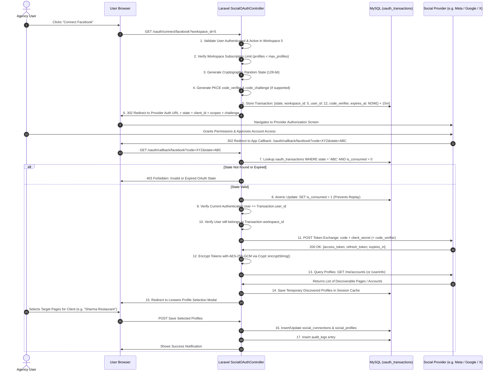
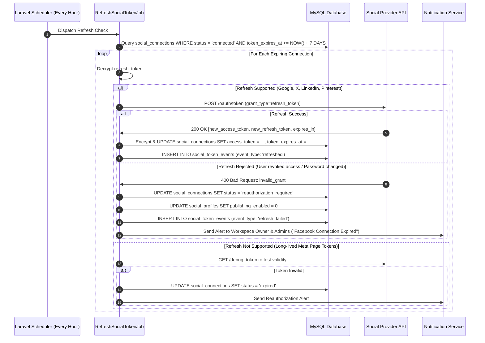

# SOCIALPILOTX — OAUTH & SECURITY ARCHITECTURE
**Document ID:** `SPX-DOC-005`  
**Phase:** `Phase 0 — Authentication, OAuth 2.0 PKCE & Encryption Blueprint`  

---

## 1. High-Security OAuth Handshake Sequence Diagram

This diagram visualizes how SocialPilotX executes an authorization flow while neutralizing **CSRF**, **State Replay**, and **Workspace-Switching / Account Hijacking Attacks**.

---

## 2. Token Lifecycle & Automated Refresh Engine

---

## 3. Cryptographic Token Protection & Storage

1. **At-Rest Encryption**:
   - Access tokens and refresh tokens are **NEVER** stored in plain text.
   - Encrypted using Laravel's native encryption service: `Illuminate\Support\Facades\Crypt::encryptString($token)`.
   - Algorithm: **AES-256-GCM** with authenticated payload (prevents bit-flipping attacks).
   - Encryption key is derived from `APP_KEY` stored in server environment variable (outside web root).

2. **In-Memory & In-Transit Isolation**:
   - Tokens are **NEVER** passed into Livewire public properties or Blade template HTML.
   - Tokens are stripped from all JSON log outputs via Monolog processors.
   - API error responses sent to client contain sanitized error codes (`ERR_PROVIDER_UNAUTHORIZED`) rather than raw payload containing authorization headers.

---

## 4. Webhook Security & HMAC Verification

Incoming webhooks from Meta, X, Stripe, and Razorpay are processed through dedicated middleware:

| Provider | Signature Header | Verification Method |
|---|---|---|
| **Meta (Facebook/Instagram)** | `X-Hub-Signature-256` | `hash_equals('sha256=' . hash_hmac('sha256', $rawBody, $appSecret), $header)` |
| **Stripe** | `Stripe-Signature` | `\Stripe\Webhook::constructEvent($payload, $sigHeader, $webhookSecret)` |
| **Razorpay** | `X-Razorpay-Signature` | `hash_equals(hash_hmac('sha256', $rawBody, $webhookSecret), $header)` |
| **X (Twitter)** | `X-Twitter-Webhooks-Signature` | `hash_equals('sha256=' . base64_encode(hash_hmac('sha256', $rawBody, $consumerSecret, true)), $header)` |

- Requests failing signature verification are instantly aborted with `401 Unauthorized`.
- Verified payloads are saved into `webhook_events` with unique constraint `(provider, event_id)` to ensure **Idempotent Ingestion**.

