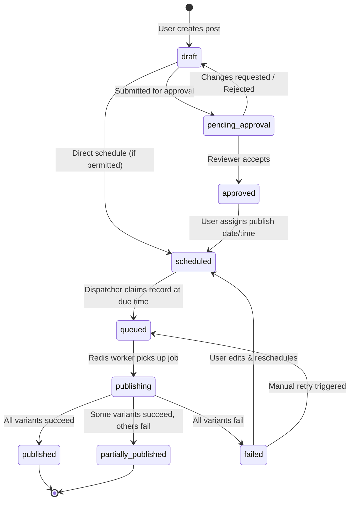
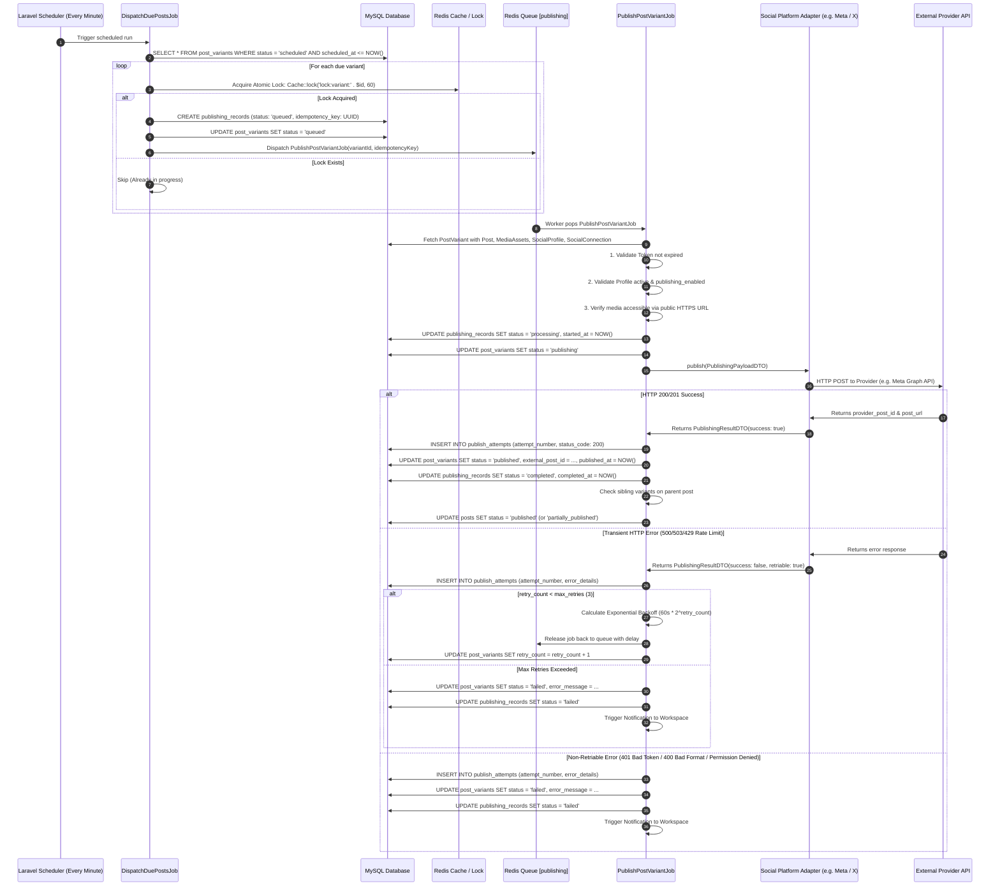

# SOCIALPILOTX — PUBLISHING ENGINE & WORKFLOWS
**Document ID:** `SPX-DOC-006`  
**Phase:** `Phase 0 — Asynchronous Execution & Fault-Tolerant Publishing Pipeline`  

---

## 1. Publishing Engine Lifecycle & State Machine

Every post exists at two distinct levels:
1. **Parent Post (`posts`)**: The umbrella campaign container authored by the user.
2. **Post Variant (`post_variants`)**: The platform-tailored message bound to a specific social profile.



---

## 2. Asynchronous Queue Topology (Redis + Supervisor)

The queue pipeline is partitioned into distinct Redis queues to prevent resource starvation (e.g., heavy video uploads will never block high-priority publishing jobs):

```
+---------------------------------------------------------------------------------------+
|                                    REDIS QUEUE CLUSTER                                |
+------------------+------------------+------------------+------------------+-----------+
|    publishing    |      media       |    analytics     |     reports      |  default  |
| (Priority: HIGH) | (Priority: MED)  | (Priority: LOW)  | (Priority: LOW)  | (General) |
+------------------+------------------+------------------+------------------+-----------+
         |                  |                  |                  |               |
+--------v------------------v------------------v------------------v---------------v-----+
|                          SUPERVISOR MANAGED PHP WORKERS                               |
|  - Worker Group 1 (Publishing): php artisan queue:work --queue=publishing,default    |
|  - Worker Group 2 (Media/Transcode): php artisan queue:work --queue=media             |
|  - Worker Group 3 (Analytics/Reports): php artisan queue:work --queue=analytics,reports|
+---------------------------------------------------------------------------------------+
```

---

## 3. End-to-End Publishing Execution Sequence



---

## 4. Fault Tolerance, Idempotency & Partial Publishing

### Idempotency Keys
Before a job communicates with a remote API, an `idempotency_key` (UUID v4) is stamped on the `publishing_records` row. Platforms supporting native client request tokens (such as LinkedIn, Stripe, and X) receive this key in headers to guarantee that network timeouts do not cause duplicate publication.

### Uncertain Network Timeout Reconciliation
If a worker encounters a `ConnectionException` or cURL timeout (HTTP 0) after sending payload bytes:
1. **DO NOT blindly re-post**.
2. Mark variant as `status = 'publishing'` with `reconciliation_required = true`.
3. Dispatch `ReconcileUncertainPublishJob` with a 2-minute delay.
4. The reconciler calls the platform's query endpoint (e.g., `GET /{page-id}/feed` or `GET /2/users/{id}/tweets`) searching for the specific caption text or client timestamp.
5. If found, mark as `published` with the discovered provider post ID.
6. If confirmed absent, safely retry.

### Partial Publishing Handling
When a user targets 4 profiles (e.g., Facebook Page, Instagram, LinkedIn, X):
- If Facebook, Instagram, and LinkedIn publish successfully, but X fails due to rate limits:
  - Facebook Variant: `status = 'published'`
  - Instagram Variant: `status = 'published'`
  - LinkedIn Variant: `status = 'published'`
  - X Variant: `status = 'failed'`
  - Parent Post: `status = 'partially_published'`
- In the UI, the user sees clear badges. A **"Retry Failed Platform"** button enables the user to re-attempt publishing specifically for the failed X variant without re-publishing to Facebook, Instagram, or LinkedIn!

